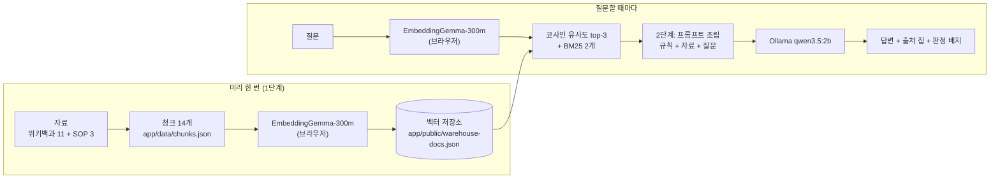

# 물류창고 재고 조사 안내 챗봇 (로컬 RAG)

물류창고에 새로 온 작업자가 재고 실사 절차와 용어를 물으면, **위키백과 공개 문서와 현장 SOP에서 근거를 찾아** 답하는 챗봇입니다.
내 PC에서 돌아가는 웹 화면이며, 질문 임베딩은 브라우저에서, 답변은 로컬 Ollama(`qwen3.5:2b`)가 만듭니다.

- **답하는 것**: 재고 실사 절차(순환재고조사, 실사 차이 처리, 안전 수칙), 재고·재고관리·WMS·ABC 분석·선입선출법·RFID·재고자산 같은 용어
- **답하지 않는 것**: 실시간 재고 수량(예: "A-01 재고 몇 개야?")은 자료에 없습니다. 실시간 수량은 **WMS(창고 관리 시스템)**에서 확인합니다.

> 화면과 앱 구조는 [모두콘 안내 챗봇](https://github.com/suncreation/moducon-chatbot)을 그대로 쓰고, **데이터(청크·벡터)와 문구, 프롬프트를 물류창고 도메인으로 바꿨습니다.** 데이터·프롬프트 규칙은 과제 가이드 「물류창고 재고 조사 안내 챗봇: 내 PC에서 끝나는 RAG 2단계」를 따랐습니다. 가이드와 다르게 한 곳은 [설계 결정](#설계-결정-가이드원본과-다른-점)에 적었습니다.

---

## 1. 동작 원리



1. 자료를 **사실 하나씩** 잘라 청크 14개를 만들고, 청크마다 출처(url)를 함께 둡니다.
2. 임베딩 모델이 청크마다 **숫자 768개짜리 벡터**를 만들고 길이를 1로 맞춥니다. 뜻이 비슷한 문장일수록 벡터 방향이 비슷합니다.
3. 질문도 **같은 모델·같은 방식**으로 벡터를 만든 뒤, 모든 청크와 내적(= 코사인 유사도)을 계산해 상위 3개를 고르고, 단어 검색(BM25)으로 2개를 더합니다. **여기까지가 1단계(검색)**입니다.
4. 2단계에서는 찾은 청크와 질문을 "자료에 근거해서만 답하고 ID를 [WH-012]처럼 달아라"는 규칙과 함께 LLM에 넘깁니다.
5. 답변은 만들어지는 대로 화면에 나오고(스트리밍), 아래에 **프로그램이 직접** LLM에게 넘긴 자료 목록(출처 칩)을 보여 줍니다. 1위 점수가 0.55 미만이면 ⚠ 약한 근거 배지가 붙습니다.

---

## 2. 사용 기술

| 구분 | 사용한 것 |
|---|---|
| 화면 | React 19 + Vite 8 + TypeScript (모두콘 안내 챗봇 구조) |
| 임베딩 | `onnx-community/embeddinggemma-300m-ONNX`의 `model_no_gather_q4` 파일, 브라우저 onnxruntime-web(WASM), mean pooling + 정규화, 768차원 |
| 임베딩 입력 형식 | 모델 카드 공식 형식. 문서 `title: {section} \| text: {text}`, 질문 `task: search result \| query: {질문}` |
| 검색 | 코사인 유사도 상위 3개 + BM25(k1=1.5, b=0.75) 상위 2개, 총 5개. 약한 근거 기준 `WEAK_THRESHOLD = 0.55` |
| LLM | Ollama `qwen3.5:2b` (`http://localhost:11434`), 스트리밍, `think: false`, `temperature: 0` |
| 자동 평가 | LLM-as-a-Judge — 같은 `qwen3.5:2b`가 근거 충실성·환각 통제·출처 표시를 채점(자기평가, 참고용) |

---

## 3. 실행 방법

### 준비

```powershell
ollama pull qwen3.5:2b
```

```powershell
cd app
```

```powershell
npm install
```

### 실행

```powershell
npm run dev
```

- 터미널에 나온 주소(`http://localhost:5173/`)를 Chrome에서 엽니다.
- 첫 질문 때 임베딩 모델을 내려받습니다(첫 방문 1회, 이후 브라우저에 캐시).
- 화면 위 배지가 `ollama 연결됨`이면 준비 완료입니다. `ollama 미연결`이면 Ollama 앱이 켜져 있는지 `curl.exe http://localhost:11434/api/tags`로 확인합니다.

### 청크를 고쳤을 때: 벡터 저장소 다시 만들기

`app/data/chunks.json`을 고쳐도 벡터는 저절로 바뀌지 않습니다. `npm run dev`가 켜진 상태에서 아래 주소를 열고 **만들기**를 누릅니다.

```text
http://localhost:5173/build-vectors.html
```

- 청크를 먼저 검사합니다(필드 누락·중복 id는 중단, 120자 미만은 경고).
- 질문 임베딩과 **똑같은 브라우저 모델**로 청크마다 벡터를 만들어 `app/public/warehouse-docs.json`에 저장합니다.
- 정상이면 마지막 줄이 `저장: public/warehouse-docs.json — 14청크 × 768차원`이고, 첫 벡터의 노름이 `1.0000`입니다.

### 파일 구조

```text
warehouse-chatbot/
├─ README.md
└─ app/
   ├─ data/chunks.json              청크 원본 14개 { id, text, url, section }
   ├─ public/docs/sop.md            현장 SOP (교육용 예시, 청크 출처)
   ├─ public/warehouse-docs.json    벡터 저장소 (14 × 768)
   ├─ build-vectors.html            청크 검사 → 임베딩 → 저장 (개발 서버 전용)
   ├─ vite.config.ts                build-vectors.html의 저장 요청을 받는 개발 서버 플러그인
   └─ src/
      ├─ rag.ts                     임베딩·검색(벡터+BM25)·시스템 메시지·프롬프트 조립
      ├─ ollama.ts                  Ollama 연결 확인·스트리밍
      ├─ judge.ts / gemini.ts       LLM-as-a-Judge, Gemini 선택 엔진
      └─ App.tsx                    화면
```

---

## 4. 자료(청크)

### 청크 설계 원칙

1. **한 청크에 사실 하나.** 주제가 섞이면 엉뚱한 질문에도 걸립니다.
2. **혼자 읽어도 뜻이 통하게.** 앞 문맥이 필요한 문장으로 시작하지 않습니다. 최소 120자.
3. **원문에 없는 말을 보태지 않기.** 위키백과 청크는 원문 문장을 그대로 이어 붙였고, 원문(위키백과 API로 받은 본문)에 문장이 들어 있는지 스크립트로 대조했습니다(11개 모두 통과).

### 청크 목록

| id | section | 글자 수 | 출처 |
|---|---|---:|---|
| WH-001 | 재고의 정의 | 209 | [위키백과 재고](https://ko.wikipedia.org/wiki/%EC%9E%AC%EA%B3%A0) |
| WH-002 | 재고관리의 대상 | 148 | [위키백과 재고관리](https://ko.wikipedia.org/wiki/%EC%9E%AC%EA%B3%A0%EA%B4%80%EB%A6%AC) |
| WH-003 | 재고관리의 목적 | 149 | [위키백과 재고관리](https://ko.wikipedia.org/wiki/%EC%9E%AC%EA%B3%A0%EA%B4%80%EB%A6%AC) |
| WH-004 | 재고수량 결정 | 206 | [위키백과 재고관리](https://ko.wikipedia.org/wiki/%EC%9E%AC%EA%B3%A0%EA%B4%80%EB%A6%AC) |
| WH-005 | 창고 관리 시스템(WMS)의 정의 | 153 | [위키백과 창고 관리 시스템](https://ko.wikipedia.org/wiki/%EC%B0%BD%EA%B3%A0_%EA%B4%80%EB%A6%AC_%EC%8B%9C%EC%8A%A4%ED%85%9C) |
| WH-006 | WMS의 핵심 기능 | 198 | [위키백과 창고 관리 시스템](https://ko.wikipedia.org/wiki/%EC%B0%BD%EA%B3%A0_%EA%B4%80%EB%A6%AC_%EC%8B%9C%EC%8A%A4%ED%85%9C) |
| WH-007 | ABC 분석 | 154 | [위키백과 ABC 분석](https://ko.wikipedia.org/wiki/ABC_%EB%B6%84%EC%84%9D) |
| WH-008 | ABC 등급 구분 | 195 | [위키백과 ABC 분석](https://ko.wikipedia.org/wiki/ABC_%EB%B6%84%EC%84%9D) |
| WH-009 | 선입선출법(FIFO) | 159 | [위키백과 선입 선출법과 후입 선출법](https://ko.wikipedia.org/wiki/%EC%84%A0%EC%9E%85_%EC%84%A0%EC%B6%9C%EB%B2%95%EA%B3%BC_%ED%9B%84%EC%9E%85_%EC%84%A0%EC%B6%9C%EB%B2%95) |
| WH-010 | RFID와 바코드 | 213 | [위키백과 RFID](https://ko.wikipedia.org/wiki/RFID) |
| WH-011 | 재고자산의 정의와 종류 | 178 | [위키백과 재고자산](https://ko.wikipedia.org/wiki/%EC%9E%AC%EA%B3%A0%EC%9E%90%EC%82%B0) |
| WH-012 | 순환재고조사 | 264 | `docs/sop.md#순환재고조사` |
| WH-013 | 실사 차이 처리 | 271 | `docs/sop.md#실사-차이-처리` |
| WH-014 | 안전 수칙 | 241 | `docs/sop.md#안전-수칙` |

SOP(`app/public/docs/sop.md`)는 실제 회사 기밀이 아닌 **교육용 예시**입니다.

---

## 5. 1단계 관찰 기록: 검색은 무엇을 잘하고 무엇을 못하나

같은 모델·같은 입력 형식, 청크 14개. 각 질문의 1위와 2위 점수(벡터 코사인 유사도)입니다.

| # | 질문 | 유형 | 1위 청크 | 점수 | 관찰 |
|---|---|---|---|---|---|
| 1 | 재고 실사 차이가 나면 어떻게 처리해? | 정상 | WH-013 실사 차이 처리 | 0.800 | 정확히 찾음. 2위 재고의 정의 0.606과 차이가 큼 |
| 2 | 실사 수량이 장부랑 안 맞으면? | 다른 표현 | WH-013 실사 차이 처리 | 0.709 | "차이", "처리"라는 단어가 없어도 같은 청크를 찾음 |
| 3 | ABC 분석이 뭐야? | 정상 | WH-007 ABC 분석 | 0.710 | 2위 ABC 등급 구분 0.708. 같은 주제 두 청크가 나란히 |
| 4 | RFID랑 바코드 차이 | 정상 | WH-010 RFID와 바코드 | 0.827 | 2위 0.515로 확실히 구분 |
| 5 | 안전재고는 어떻게 계산해? | 경계 | WH-001 재고의 정의 | 0.619 | 2위가 "안전" 때문에 **안전 수칙**(0.602): 엉뚱한 끌림. 재고수량 결정(WH-004)은 3위 0.596 |
| 6 | A등급 품목은 얼마나 자주 세? | 경계 | WH-008 ABC 등급 구분 | 0.664 | 실제 답(월 1회)이 있는 순환재고조사(WH-012)는 2위 0.656. **답에 두 청크가 필요** |
| 7 | 우리 창고 지금 A-01 재고 몇 개야? | 도메인 밖 | WH-012 순환재고조사 | 0.548 | 0.55 바로 아래라 ⚠가 뜸. "재고"라는 말 때문에 무관한 질문보다 점수가 높음 |
| 8 | 내일 날씨 어때? | 무관 | WH-013 실사 차이 처리 | 0.452 | ⚠ 무관하면 점수가 확 낮아짐 |
| 9 | 김치찌개 레시피 알려줘 | 무관 | WH-004 재고수량 결정 | 0.400 | ⚠ |

### 생각해 볼 것

1. **2번처럼 단어가 겹치지 않아도 찾을 수 있는 이유는?**
   임베딩이 단어가 아니라 **뜻**을 비교하기 때문입니다. "장부랑 안 맞으면"과 "장부 수량이 다르면"은 글자는 달라도 뜻의 좌표가 가깝습니다.
2. **8·9번도 1위 청크는 항상 나옵니다.**
   검색은 "가장 가까운 것"을 고를 뿐, "답이 있는지"는 모릅니다. 그래서 점수 기준(0.55)으로 약한 근거를 표시합니다.
3. **7번은 기준선(0.55)에 0.002 차이로 걸렸습니다.**
   "재고"라는 말 때문에 무관한 질문(0.40~0.45)보다 훨씬 높게 나와, 자료를 조금만 바꿔도 기준을 넘을 수 있습니다. **검색 점수만으로는 "실시간 수량은 자료에 없다"를 안정적으로 걸러 낼 수 없습니다.** 그래서 2단계에서 LLM에게 규칙(시스템 메시지)으로 알려 줍니다.
4. **5번의 2위처럼 단어 하나("안전")에 끌려 엉뚱한 청크가 올라오기도 합니다.** 그래서 LLM에게 "근거에 있는 것만" 쓰라고 합니다.

---

## 6. 2단계 기록: 답변

화면에서 직접 질문한 결과입니다(로컬 `qwen3.5:2b`, CPU).

| 질문 | 답변 핵심 | ID 표시 | 지어낸 내용 | 자기평가 점수 |
|---|---|---|---|---|
| 재고 실사 차이가 나면 어떻게 처리해? | 재실사 → 입고 전표·이동 이력·피킹 기록 순서로 확인 → 원인 분류 → 관리자 승인 후 WMS 반영 | [WH-013] | 없음 | 100 |
| A등급 품목은 얼마나 자주 세? | "A등급 품목은 월 1회 조사를 수행합니다." | [WH-012] | 없음 | 53 |
| 우리 창고 지금 A-01 재고 몇 개야? | "제가 가진 자료에는 없습니다" + ⚠ 54.8% | 없음 | 없음. 다만 **WMS 확인 안내는 빠짐** | 0 |
| 내일 날씨 어때? | "제가 가진 자료에는 없습니다" + ⚠ 45.2% | 없음 | 없음 | 33 |

### 비교 실험: RAG가 있을 때와 없을 때

같은 질문을 **RAG 없이**(검색·시스템 메시지 없이 질문만, `qwen3.5:2b`, `think: false`, `temperature: 0`) Ollama에 직접 보낸 결과와 비교했습니다.

| 질문 | RAG 없이 (핵심 문장) | RAG (핵심 문장) | 지어낸 내용? | 내 판단 |
|---|---|---|---|---|
| 재고 실사 차이가 나면 어떻게 처리해? | 실사 차이를 "실제 판매량과 예상 판매량"의 차이로 오해하고 가격 조정·마케팅·해외 매각을 권함 (33.9초) | 재실사 → 원인 확인 순서 → 원인 분류 → 관리자 승인 후 WMS 반영 [WH-013] | RAG 없이: **질문 자체를 잘못 이해하고 지어냄** | RAG가 SOP 절차로 바로잡음 |
| A등급 품목은 얼마나 자주 세? | A등급을 상점 진열 빈도로 해석해 "매일/주말", "수요일~금요일" 같은 주기를 지어냄 (22.4초) | "월 1회" [WH-012] | RAG 없이: **지어낸 주기** | RAG가 SOP의 주기를 정확히 옮김 |
| 우리 창고 지금 A-01 재고 몇 개야? | 숫자는 지어내지 않고 "ERP·WMS에서 확인하라"고 안내한 뒤 어떤 창고인지 되물음 (6.2초) | "제가 가진 자료에는 없습니다" | 둘 다 없음 | RAG 쪽이 WMS 안내를 빠뜨림. 이 질문은 RAG 없는 쪽이 더 친절 |
| 내일 날씨 어때? | 실시간 날씨는 모른다며 검색 엔진을 권함 (5.6초) | "제가 가진 자료에는 없습니다" + ⚠ | 둘 다 없음 | 둘 다 거부. RAG는 ⚠ 배지로 근거가 약함을 보여 줌 |

- RAG는 **도메인 질문의 환각을 크게 줄였습니다.** RAG 없이는 "실사 차이"·"A등급"을 판매·진열 이야기로 잘못 읽고 그럴듯한 답을 지어냈습니다.
- 도메인 밖 질문(A-01 재고, 날씨)은 RAG가 없어도 지어내지 않았습니다. 다만 RAG 쪽은 "자료에 없다"만 말해 안내가 짧았습니다.

### 읽는 법

- 1번 답변은 SOP 문장을 거의 그대로 옮겼고, 맨 앞에 자료 줄의 머리 `[WH-013] (실사 차이 처리)`까지 베껴 썼습니다. 작은 모델은 **눈앞의 모양을 따라 하는** 경향이 강합니다.
- 2번은 1위 청크(ABC 등급 구분)가 아니라 2위 청크(순환재고조사)에서 "월 1회"를 찾아 맞게 답했습니다. 검색을 5개로 넉넉히 넘긴 효과입니다.
- 시스템 메시지에 "실시간 수량은 WMS에서 확인하라고 안내"를 넣었지만 2B 모델은 이 규칙을 빠뜨렸습니다. 지어내지는 않았습니다.
- **자기평가 점수는 믿기 어렵습니다.** 맞게 답한 2번에 53점, 정당하게 거부한 3번에 0점을 줬습니다. 같은 2B 모델이 자기 답을 채점하기 때문입니다. 점수는 참고용으로만 보고, 출처 칩의 원문과 직접 대조합니다.

---

## 설계 결정 (가이드·원본과 다른 점)

| 항목 | 이 저장소 | 이유 |
|---|---|---|
| 화면 | 웹 화면(모두콘 앱 재사용) | 가이드는 PowerShell CLI. 과제 1번에서 돌린 모두콘 앱에 데이터만 바꿔 넣는 방식으로 했습니다 |
| 임베딩 파일 | `model_no_gather_q4` (브라우저) | 가이드는 Node `q8`. 브라우저 WASM에서 q8 기본 파일이 돌지 않아 원본 앱이 쓰는 변형을 그대로 썼습니다 |
| 문서 벡터 만들기 | 브라우저(`build-vectors.html`) | 질문 벡터와 **같은 모델 파일·같은 계산**으로 만들어야 비교가 맞기 때문입니다 |
| 질문 접두어 | `task: search result \| query: ` 추가 | 원본 앱에는 없었음. 가이드 STEP 3 계약(모델 카드 공식 형식) |
| 검색 개수 | 벡터 3 + BM25 2 = 5개 | 원본은 15개. 청크가 14개뿐이라 15개면 자료 전부가 넘어가 검색 의미가 없어집니다 |
| 프롬프트 | 가이드 STEP 6 형식 (`[WH-xxx] (section) text`, 출처 규칙을 끝에 한 번 더) | 원본은 `[ID \| section]` 형식이라 작은 모델이 머리를 통째로 베끼기 쉽습니다 |
| 청크 수 | 14개 (가이드 13개) | 재고자산 문서를 청크 하나로 추가했습니다 |

---

## 7. 한계와 다음 단계

- **2B 모델의 한계**: 규칙(WMS 안내)을 빠뜨리고, 자료 줄의 머리를 베껴 쓰고, 자기평가 점수가 들쭉날쭉합니다.
- **검색만으로 "답이 없음"을 판단하기 어렵습니다**: A-01 재고 질문은 0.548로 기준선(0.55)에 거의 붙었습니다. 도메인 단어가 들어간 도메인 밖 질문을 가르는 방법이 더 필요합니다.
- **다음에 해 볼 것**
  - 입고 검수 절차 같은 md 문서를 더 넣고, 추가 전·후 검색 결과 비교(가이드 STEP 5 선택 실습)
  - 시스템 메시지를 줄이거나 바꿔 WMS 안내가 나오는지 한 가지씩 바꿔 보기(가이드 STEP 8 선택 실험)
  - 판정을 다른 모델(Gemini 엔진)로 돌려 자기평가와 비교
